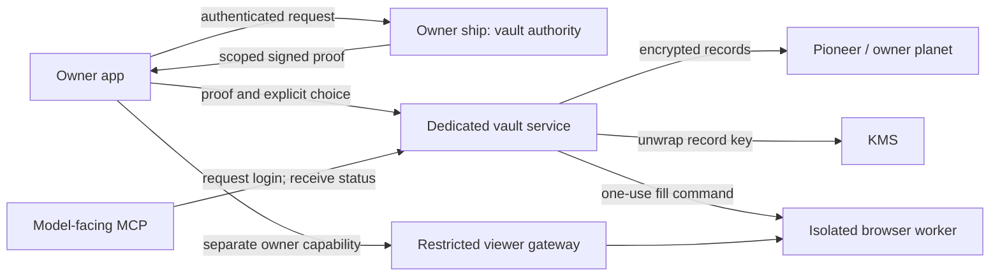

# Browser login vault: proposed security boundaries

Status: design proposal for [TLON-6771](https://linear.app/tlon/issue/TLON-6771).
The client controls in [PR #6733](https://github.com/tloncorp/tlon-apps/pull/6733)
do not establish these service boundaries. Saved-login rollout depends on them.

## Recommended design

The owner authorizes an operation, a dedicated vault service enforces that
authorization, and a browser worker fills the approved destination. The model
receives an outcome, never a credential or a browser-control capability.

The website necessarily receives its login credentials. This design does not
claim protection from a malicious destination website, a compromised owner
device, or a compromised vault service authorized to decrypt a record.

## 1. Dedicated owner authorization

Use a signing key dedicated to vault authorization, held by an owner-only ship
agent. Pioneer and the vault verify its public key, registered through an
authenticated owner-ship channel. A key supplied with the request is not a
trust anchor. Do not reuse `%genuine`, including as the key for derived HMAC
proofs: Memex also holds that secret and can mint those proofs.

An owner proof identifies its issuer and key ID, vault audience, planet, bot
moon, operation, expiry, and nonce. Login grants additionally bind the exact
HTTPS origin, record ID/revision, browser session, and prepared form. Use a short
expiry, such as two minutes. Consume mutation nonces atomically before work;
retries return the recorded outcome for the same request identity. List authority
does not authorize use, save, update, or deletion. Recheck ownership and the
record's current revision at execution.

Expose issuance only through the owner's authenticated client path. Rotate the
signing key and revoke outstanding grants without deleting saved records. A
same-origin compromise of an authenticated ship UI can still act as the owner;
isolating that UI or requiring an independent confirmation is a separate control.

## 2. Separate human control from model tools

Deliver viewer capabilities through the private application path. Omit them
from model-visible text, structured results, errors, traces, and session lists.
The application-only MCP action needs caller authorization, not merely a
hidden tool description. Bind a viewer capability to the authenticated owner,
session, allowed operations, and expiry.

Do not expose raw CDP through a viewer bearer. The viewer supports an allowlist
of display and input operations through the gateway. Debug CDP requires a
separate operator identity and is unreachable from Chrome's network and the
model-facing tools. Validate this boundary at the gateway and network layer.

HTTP/HTTPS navigation validation is necessary but insufficient: audit links,
keyboard shortcuts, uploads, scripting tools, redirects, and internal service
reachability. Browser workers need egress policy that denies control-plane,
metadata, and private-service access, including redirects and DNS changes.

## 3. Isolate the vault and narrow decryption authority

Run vault operations separately from the process handling MCP tools and
untrusted browser output. Use distinct service identities and network policy.
MCP cannot read encryption keys, request arbitrary decryption, or retrieve
plaintext records. The vault sends a one-use fill command directly to the
browser worker after checking the session, origin, form, record, and policy.

Use per-record data keys wrapped by KMS, with planet, moon, record, and revision
as authenticated context. Store ciphertext and wrapped keys on the planet.
Restrict KMS permissions to the vault identity and the expected context; record
auditable use events without secrets. KMS reduces key exposure but does not
prevent a compromised authorized vault from misusing decryption permissions.

Preserve encrypted records during rollout and rollback. Any record-format
transition needs a separately reviewed migration and recoverability plan;
disabling the feature must not erase the vault.

## 4. Make automatic login an explicit policy

Recommend **ask each time** as the default per-login policy. An owner can grant
automatic use to a specific bot and exact origin. Saving a password and granting
automatic use are separate decisions, enforced by the vault rather than prompt
instructions. Updating, deleting, or changing the policy invalidates outstanding
use grants.

Have the trusted harness deliver a use notice to the owner, correlated with a
vault receipt. Delivery must not depend on the model choosing to report it.
Include the site, bot, time, and outcome; omit the password and unnecessary
account metadata. Login authority grants no purchase or other transaction
approval. Removing a login does not revoke website cookies already in Chrome;
offer ending the associated browser session as a distinct action.

## 5. Treat output redaction as a separate boundary

DOM attributes alone cannot track secrets through re-renders. Track protected
values independently within the browser worker and redact model-visible values,
accessible names, text, titles, URLs, logs, and errors. Invalidate cached
snapshots when protection changes. Screenshots, recordings, downloads, clipboard
reads, and other raw outputs must fail closed when they can expose protected
content.

Prefer a restricted login phase: pause model inspection while credentials are
present, and resume through a sanitized outcome after the worker verifies the
transition. Exact-value matching is defense in depth; it cannot reliably detect
arbitrary encodings or transformations by page scripts. Do not claim that
matching alone makes arbitrary post-fill page inspection safe.

## Implementation order and acceptance

1. Keep the vault disabled while integrating the client fixes and enforcing
   HTTP/HTTPS navigation at the shared direct/batch browser boundary.
2. Separate owner-viewer and debug control capabilities, and audit every
   model-visible result and alternate browser-control path.
3. Implement the independent proof issuer and isolated vault execution path.
4. Add enforced per-login policy, trusted use receipts, and protected-output
   handling before enabling automatic reuse.
5. Run a canary with two planets and two moons, synthetic credentials, and
   explicit rollback verification before a broader rollout.

Required regressions cover cross-tenant and cross-origin access, stale record
revisions, expired/replayed grants, signing-key and policy revocation, canceled
handoffs, independent Memex credentials, raw-CDP denial, and Chrome access to
internal services. Exercise re-rendered fields, accessible labels, titles,
echoed text, transformed values, screenshots, and recordings. Test failures
must not be interpreted as permission to widen a grant or disable redaction.

Keep the current `sess_` handle contract while reconciling the companion MCP
branch. Readable session names are an independent API change, not a vault
requirement. Coordinate it separately rather than adding two handle formats.

The review's allegation that moons inherit parent `%settings` write access is
explicitly retracted in its follow-up. Do not redesign storage on that premise;
retain an integration test proving the pinned runtime's actual isolation.

## Companion work

- [Pioneer #3302](https://github.com/tloncorp/ylem/pull/3302): verify scoped owner
  proofs, enforce record operations, preserve encrypted storage.
- [Steel browser #4](https://github.com/tloncorp/steel-browser/pull/4): separate
  owner control, enforce one-use fills, isolate Chrome, protect raw outputs.
- [Steel MCP #4](https://github.com/tloncorp/steel-mcp-server/pull/4): remove
  model-visible capabilities, delegate vault policy, expose outcomes only.

The architecture recommendations respond to the
[corrected security review](https://github.com/tloncorp/tlon-apps/pull/6733#issuecomment-6019948514)
and its [consent and isolation findings](https://github.com/tloncorp/tlon-apps/pull/6733#issuecomment-6018522623).
