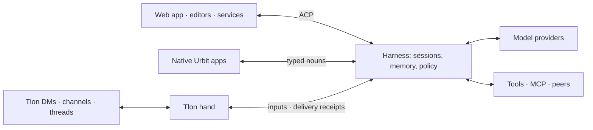

# Urbit Agent Harness

Harness runs AI agents on your Urbit ship. Talk to them in Tlon or a connected
editor. They can research, use tools, work with other agents,
and schedule follow-ups.

Your ship keeps the conversations, permissions, and work. You can switch clients
or models without moving your history, and closing a client doesn't stop work
that's underway.

## How it fits together

The **head** runs conversations and keeps their history on the ship. **Hands**
connect conversations to apps such as Tlon and track whether replies are sent.
Model providers supply inference; tools give agents access to other services.



Conversations have separate tool permissions and can work concurrently while
waiting on models and services. They share the ship's event loop.

Turns the owner drives directly, in their own DM with the bot, through ACP, a
local poke or as a peer, get every tool whatever the conversation's permissions
say, except JavaScript execution, which the conversation must opt into. The
owner's ship working as a peer has no conversation settings, so it always has
JavaScript execution. Permissions limit channels, scheduled work and
other ships. A subagent gets at most what its parent turn could use, so a
subagent of a direct owner turn is not limited by them either.

## Capabilities

- Choose models from OpenRouter, OpenAI, Anthropic, or a compatible endpoint.
- Search conversation history and pin notes that survive summarization.
- Give agents web access, ship files, reusable skills, and tools from MCP servers.
- Delegate work to local agents or mutually trusted ships.
- Use Tlon conversations, groups, Notes, and publishing.
- Schedule one-time follow-ups, recurring work, and reminders.
- Keep track of tasks and projects, and review or publish documents in **Work**.

Default tools have broad access, including HTTP, ship files, skill authoring,
and Tlon. Review permissions before connecting other people or agents.
JavaScript execution is opt-in and is not sandboxed by other tool permissions.
Tlon features and document storage need Groups; ordinary conversations do not.
Models run through configured providers, not on the ship itself.

See the [capability guide](docs-refs/capabilities.md) for scope and limits, or
[companion workflows](docs-refs/companion.md) for practical uses.

## Build and install

Create and mount a desk in Dojo:

```text
|new-desk %harness
|mount %harness
```

Build the desk, copy it into the mount and commit it. This needs `git`, `rsync`,
`python3`, `socat`, `jq`, `curl` and [yq](https://github.com/mikefarah/yq):

```sh
just commit /path/to/pier/harness
```

Install it in Dojo:

```text
|install our %harness
```

Set the owner, enable the Tlon hand and connect a model provider:

```sh
just click=scripts/click setup /path/to/pier ~owner
just click=scripts/click provider /path/to/pier chatgpt
```

Without `click=scripts/click`, `setup` and `provider` take a fake ship that
`just fake-dev` runs in a container, as `~zod`.

`chatgpt` signs in with a ChatGPT subscription. `openai`, `openrouter`, `anthropic`
and `xai` ask for an API key. Then DM the ship from the owner in Tlon.
A ship without access is not answered; the owner is sent a card asking about it
(see [authority](docs-refs/tlon.md#authority-and-conversation-scope)).

`just commit` and `just install-dev` keep files already in the mount; `just install`
replaces the mount with the assembled desk, deleting anything stale.
See [development and verification](docs-refs/development.md).

## Install on a hosted moon

Hosted moons install the desk from `~wannec-dozzod-marnus`. Once, in Dojo on
that ship, create the desk and make it readable by other ships. It is not
installed there, so its agents do not run on that ship:

```text
|new-desk %harness
|public %harness
```

The [Deploy Harness](../../.github/workflows/deploy-harness.yml) workflow,
run by hand from `develop` with a commit SHA, tag or branch, publishes that
commit's desk there. It refuses a commit without a successful Harness CI run
from a push to `develop`, and fails unless the ship ends up holding the commit.
It never runs alongside the `%groups` deploy to that ship; a push to `develop`
cancels it, and then it needs running again.

On a moon, in Dojo:

```text
|install ~wannec-dozzod-marnus %harness
```

The moon then takes every commit the workflow publishes. The desk's
`commit.txt` names the commit a ship holds:

```text
.^(wain %cx /=harness=/commit/txt)
```

## Using a conversation

Send `/help` for the shared command list. `/status` inspects the conversation,
`/model` selects its model, `/context` reports its working-context budget and
`/compact` summarizes older exchanges. `/stop` cancels active work; it cannot
undo an external action already performed.

Use `/remember preference Keep replies short.` to pin a note,
`/memory` to list notes and `/forget preference` to unpin one.
A note saved in a channel is seen in every conversation; one saved in a DM,
only there and in the owner's DM. The owner's general preferences are
recalled in every conversation. Notes survive compaction verbatim. Search
content finds retained evidence; it does not fetch every other app's history.
See [context and memory](docs-refs/context-and-memory.md).

## Connect an editor or service

Clients can connect directly to the ship's authenticated ACP API. For an editor
that expects a local stdin/stdout executable, use the bridge:

```sh
SHIP_URL=http://localhost:8081 \
SHIP_CODE=your-ship-code \
node acp/harness-acp.mjs
```

Treat the ship login code as an owner credential.
See the [adapter setup](acp/README.md) and [integration guide](docs-refs/integrations.md).

## Documentation

| Read this | For |
| --- | --- |
| [Architecture](docs-refs/architecture.md) | Ownership, lifecycle, source modules and trust boundaries |
| [Capabilities](docs-refs/capabilities.md) | Available features, authority and limits |
| [Companion workflows](docs-refs/companion.md) | Research, social collaboration and scheduled work |
| [Integrations](docs-refs/integrations.md) | Choosing ACP, native nouns, webhooks, MCP or hands |
| [ACP reference](docs-refs/acp.md) | Client methods, commands, authentication and recovery |
| [Conversation hands](docs-refs/hands.md) | Bindings, deduplication, publication receipts and retirement |
| [Shared scheduling](docs-refs/scheduling.md) | Tasks and reminders from any hand; Settings → Schedules |
| [Artifacts and projects](docs-refs/workspaces.md) | Editing, agent coordination, proposal review and public pages |
| [Conversation work management](docs-refs/work-control.md) | Text-first work controls; human confirmation for protected changes |
| [Tlon reference](docs-refs/tlon.md) | Social tools, Notes, hooks, publishing and media |
| [Peers](docs-refs/peers.md) | Ship-to-ship requests, tool RPC and administrative authority |
| [Context and memory](docs-refs/context-and-memory.md) | Summaries, pinned notes, corpus search and provenance |
| [JavaScript execution](docs-refs/execution.md) | Opt-in executor, host APIs and resource limits |
| [Development](docs-refs/development.md) | Build layout, test selection and safe live verification |
| [Reliability](docs-refs/reliability.md) | Sustained local operation, fault recovery, evidence and coverage limits |
